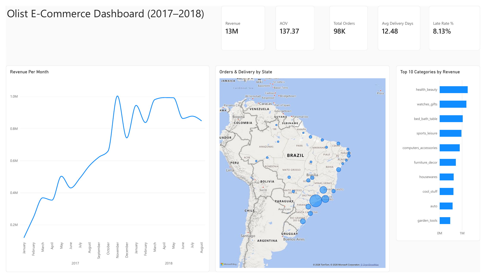
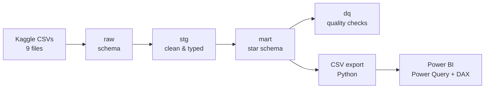
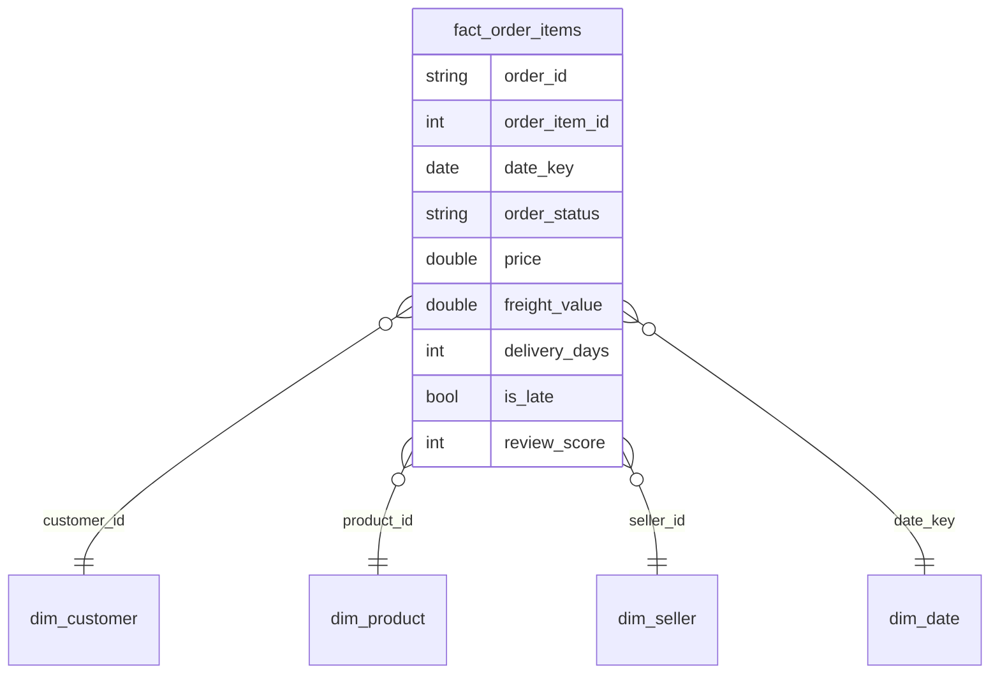

# Olist E-Commerce Data Pipeline & Dashboard

An end-to-end data project on the [Olist Brazilian E-Commerce dataset](https://www.kaggle.com/datasets/olistbr/brazilian-ecommerce) (~100K orders, 2016–2018). Raw CSVs are loaded into **DuckDB**, cleaned and modeled with **SQL** into a star schema, validated with **data quality checks**, and visualized in a **Power BI** dashboard.



## Key Insights (2017–2018, canceled orders excluded)

| KPI | Value |
|---|---|
| Revenue | **13M BRL** |
| Total Orders | **98K** |
| Average Order Value | **137.37 BRL** |
| Avg Delivery Time | **12.48 days** |
| Late Delivery Rate | **8.13%** |

- **Strong growth through 2017**, from ~0.1M BRL/month in January to a peak of ~1M BRL in **November 2017** (Black Friday), then a plateau of ~0.85–1M BRL/month in 2018.
- **Top categories by revenue:** health_beauty, watches_gifts and bed_bath_table.
- **São Paulo (SP) dominates** orders, followed by Rio de Janeiro and Minas Gerais. Customers in the North and Northeast are fewer and wait longer for deliveries.
- About **1 in 12 orders arrives late** compared to the estimated delivery date.

## Architecture



| Layer | File | What it does |
|---|---|---|
| **raw** | `sql/01_load_raw.sql` | Loads the 9 source CSVs as-is into DuckDB (`read_csv_auto`). |
| **stg** | `sql/02_staging.sql` | Cleaning & transformation (details below). |
| **mart** | `sql/03_marts.sql` | Star schema for analytics. |
| **dq** | `sql/04_dq_checks.sql` | 11 automated data quality checks. |
| **export** | `scripts/export_marts.py` | Exports marts to CSV for Power BI, adds BI-only columns (`map_location`). |
| **BI** | `dashboard/olist_dashboard.pbix` | Power BI report ([PDF version](dashboard/olist_dashboard.pdf)). |

## Data Cleaning & Transformation (SQL)

Done in the staging layer (`sql/02_staging.sql`):

- **Type casting:** string timestamps cast to `TIMESTAMP` for purchase, approval, delivery and estimated dates.
- **Derived columns:** `delivery_days` (purchase → delivery) and `is_late` (delivered after the estimated date).
- **Standardization:** city names trimmed and lower-cased, state codes upper-cased, zip prefixes left-padded to 5 digits.
- **Translation:** Portuguese product categories joined to their English names; missing values fall back to the Portuguese name, then `'unknown'`.
- **Deduplication:** multiple reviews per order reduced to the latest one using `QUALIFY ROW_NUMBER()`.
- **Aggregation:** split payments rolled up to one row per order (total, main payment type, installments).

## Data Model (Star Schema)



- **Grain of the fact table:** one row per item in an order.
- `fact_order_items` combines items, orders, payments and reviews from four staging tables.
- `dim_date` is a generated calendar (2016–2018) for time-based analysis in Power BI.

## Data Quality Checks

`sql/04_dq_checks.sql` writes results to `dq.results` and `dq.summary`. Result: **8 PASS, 3 WARN, 0 FAIL**.

| Type | Check | Result |
|---|---|---|
| Uniqueness | `orders_pk_unique`, `fact_pk_unique` | PASS |
| Not null | `orders_purchase_not_null` | PASS |
| Referential integrity | `fact_customer_fk`, `fact_product_fk` | PASS |
| Valid range | `price_positive`, `review_score_1_to_5` | PASS |
| Business logic | `delivered_before_purchase` | PASS |
| Business logic | `canceled_but_delivered` | WARN (6 orders) |
| Business logic | `delivered_missing_date` | WARN (8 orders) |
| Completeness | `unknown_category` | WARN (610 products) |

WARN rows are known source-data issues. They are kept and flagged rather than silently dropped.

## Power BI Dashboard

- **Power Query:** imported the exported CSVs, promoted headers and set data types (locale-aware for decimals).
- **Model:** 1-to-many relationships from the four dimensions to `fact_order_items`.
- **DAX measures:** `Revenue`, `Total Orders`, `AOV`, `Avg Delivery Days`, `Avg Review`, `Late Rate %`.
- **Visuals:** KPI cards, monthly revenue line, orders & delivery by state (map), Top 10 categories by revenue.
- **Filters:** years 2017–2018, canceled orders excluded.

### Challenges & Lessons Learned

- **Locale broke decimal numbers.** On a laptop with Indonesian regional settings, Power BI read `.` as a thousands separator, so prices were inflated. Fixed with *Change Type → Using Locale → English (United States)*.
- **Year filter did nothing.** The `fact → dim_date` relationship was wrong; rebuilding it as many-to-one on `date_key` fixed the filtering.
- **Incomplete periods.** 2016 has very few orders and data after August 2018 is partial, so the dashboard focuses on Jan 2017 – Aug 2018.
- **Missing translations.** Some categories had no English name; `COALESCE` keeps them visible instead of losing 610 products.

## Tech Stack

| Tool | Used for |
|---|---|
| **Python** (Jupyter, pandas) | Orchestrating the pipeline, exporting marts |
| **DuckDB** | Local analytical database |
| **SQL** | Loading, cleaning, modeling, data quality checks |
| **Power BI** | Dashboard & data visualization |
| **Power Query** | Data import and type transformations |
| **DAX** | KPI measures |

## How to Reproduce

1. **Clone and set up Python**
   ```bash
   git clone https://github.com/AbdulZaki1/olist-data-pipeline.git
   cd olist-data-pipeline
   python -m venv .venv
   .venv\Scripts\activate        # Windows (macOS/Linux: source .venv/bin/activate)
   pip install -r requirements.txt
   ```
2. **Download the data** from [Kaggle](https://www.kaggle.com/datasets/olistbr/brazilian-ecommerce) and put the 9 CSV files in `data/raw/`. (`data/` is git-ignored.)
3. **Run the pipeline:** open `notebooks/01_load.ipynb`, change the `os.chdir(...)` path in the first cell to your repo folder, and run all cells. This builds `data/olist.duckdb` with the `raw`, `stg`, `mart` and `dq` schemas.
4. **Export for Power BI**
   ```bash
   python scripts/export_marts.py
   ```
   CSVs are written to `data/export/`.
5. **Open the dashboard:** open `dashboard/olist_dashboard.pbix` in Power BI Desktop and point the data source to your `data/export/` folder. A step-by-step guide (Indonesian) is in [`docs/panduan_powerbi.md`](docs/panduan_powerbi.md).

## Project Structure

```
olist-data-pipeline/
├── sql/
│   ├── 01_load_raw.sql      # raw layer
│   ├── 02_staging.sql       # cleaning & transformation
│   ├── 03_marts.sql         # star schema
│   └── 04_dq_checks.sql     # data quality checks
├── notebooks/01_load.ipynb  # runs the SQL pipeline
├── scripts/export_marts.py  # marts -> CSV for Power BI
├── dashboard/
│   ├── olist_dashboard.pbix
│   └── olist_dashboard.pdf
├── docs/
│   ├── dashboard.png
│   └── panduan_powerbi.md
├── requirements.txt
└── data/                    # git-ignored (raw CSVs, DuckDB file, exports)
```

## Author

**Abdul Zaki**, Information Systems student. [GitHub](https://github.com/AbdulZaki1)
